# 转盘五连 Pentago Twist

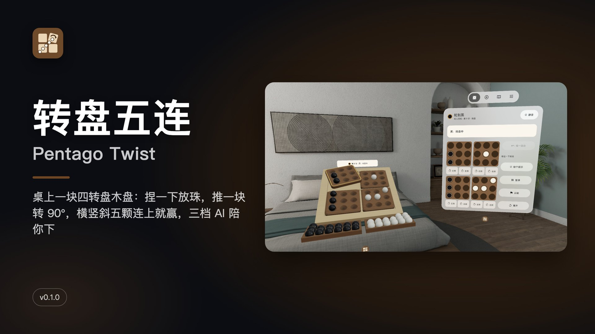

[中文](#中文) · [English](#english)

---

## 中文

**桌上一块四转盘木盘：捏一下放珠，推一块转 90°，横竖斜五颗连上就赢，三档 AI 陪你下。**

PICO 空间应用（PICO OS 6 · Spatial SDK BOM 6.1.9 · Shared Space 体积窗口）。一块 0.50 m 的木盘摆在你面前：浅色枫木框里嵌着四块 3×3 的胡桃木小转盘，手边两只浅托盘装着黑白玻璃珠。规则是经典的 Pentago：每回合先放一颗珠，再把任意一块小转盘转 90°；横、竖、斜五颗连上就赢。

### 能做什么

- **放珠**：指着哪个凹坑捏一下，珠子从托盘里沿弧线飞过去「嗒」地嵌进坑
- **转盘**：按住一块小转盘推一下，或点它边上的弯箭头，它抬起来带着上面的珠子「咔」地转 90° 落回去
- **转完才连上**：转盘之后才凑成的五颗，会沿线一颗一颗亮起来
- **对手**：本机 AI 三档（入门 / 中级 / 高手），或两个人同机轮流下；悔一回合、撤回这颗、给个提示、认输、重开
- **系统原生窗口**：棋盘在系统立体窗口里；右侧控制窗四页（对局 / 新局 / 规则 / 设置），对局页的小棋盘有 36 个格键和 8 个转盘键，和在盘上捏合走同一条路径
- 倾角 0° / 30° / 45° / 60° / 90°、大小 100% / 120%；每一步自动存档；音量三档、静音、减少动态；手势捏合 / 手柄射线；中英双语；本机运行，不联网、不要账号

### 截图

> v0.1.0 截图来自 PICO 模拟器（中文界面），由调试广播驱动，**非真实手势录像**。演示视频 `video-01.mp4` 在 Release 资产里（同样非真实手势录像，无声）。

| | |
|---|---|
|  转盘中：黑放下 c4 后把左上块顺时针转 90°，块抬起来带着珠子转 | 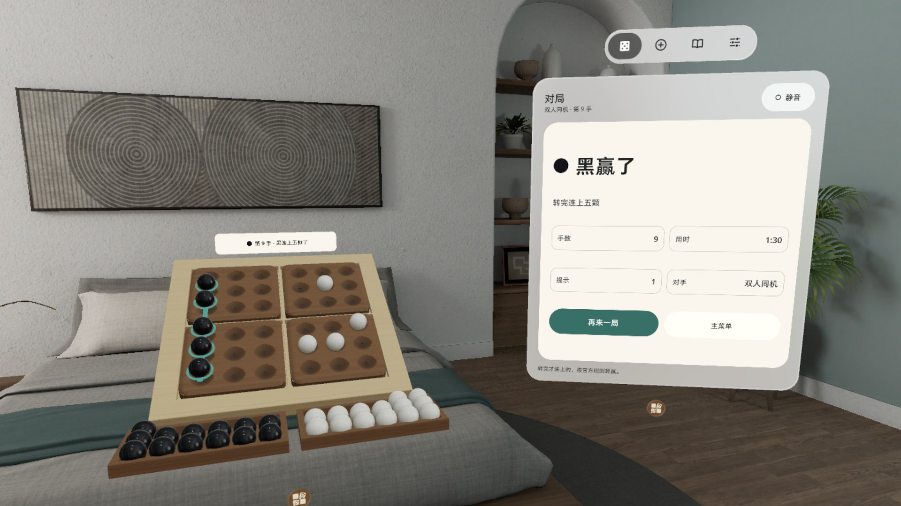 转完连上：a 列五颗沿线亮起，控制窗「黑赢了 · 转完连上五颗」 |
| 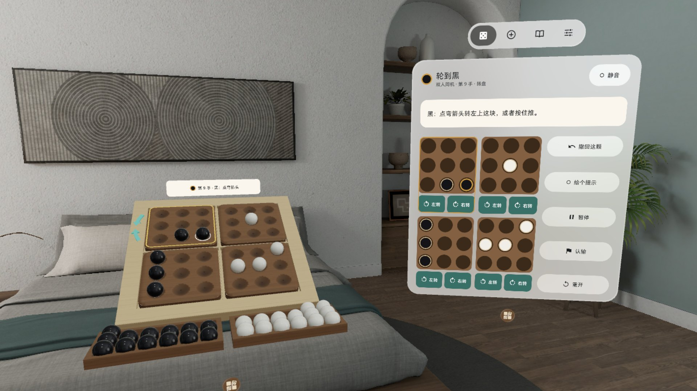 选块：左上块边沿亮起、弯箭头出现，小棋盘的转盘键变绿 | 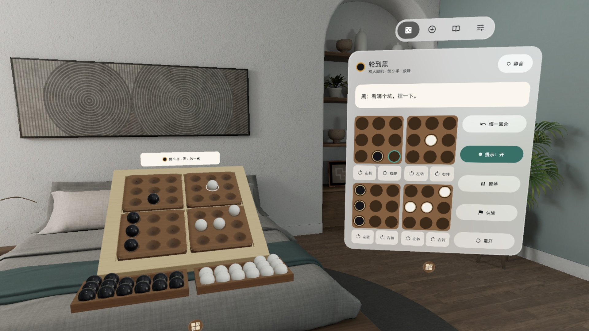 提示开着：盘上和小棋盘上用青环标出建议的坑 |
| 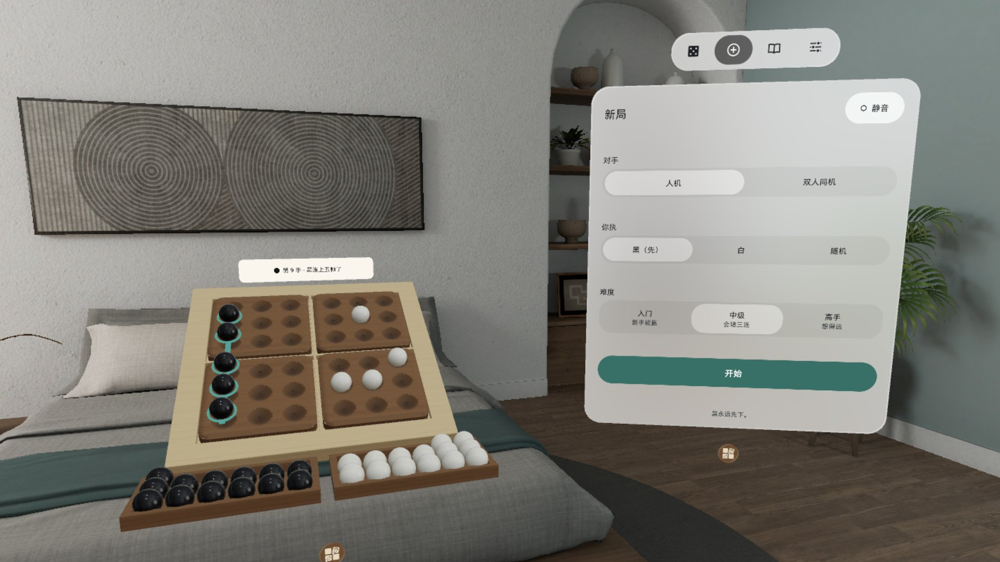 新局：人机 / 双人、执黑 / 执白 / 随机、三档难度 | 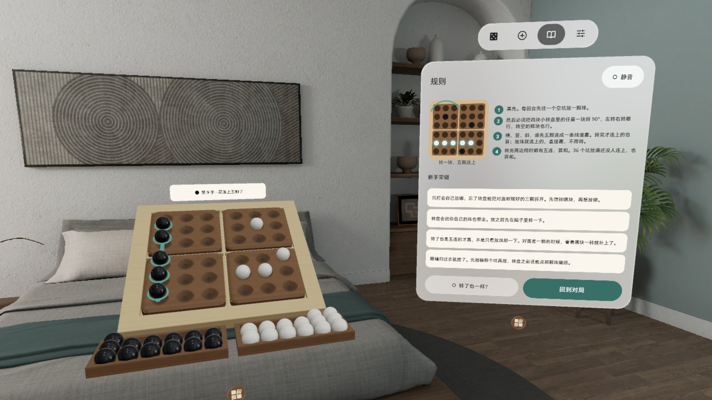 规则：一张图解 + 四条规则 + 新手常错 |

### 安装

[Release v0.1.0](https://github.com/kejing-dev/PentagoTwist/releases/tag/v0.1.0) 里的 `PentagoTwist-v0.1.0.apk` 是 `assembleRelease` 出的未签名包（给应用商店上架用，`adb install` 会拒绝）。自己装请从源码构建 debug 包，头显开启开发者模式并用 USB 连上电脑：

```bash
./gradlew assembleDebug
adb install -r app/build/outputs/apk/debug/app-debug.apk
pico-cli app launch io.embodit.pentagotwist
```

需要 PICO OS 6（Android 15，minSdk 35）。不需要额外权限。

### 已知问题

1. 首局教练提示写「眼睛停在坑上会先出一颗虚珠」，真机上多半看不到虚珠（Shared Space 不派发 hover）。
2. 放珠或转盘过程中，[悔一回合] 下方的置灰原因文案和当前动作对不上。
3. 冷启动约 3 秒时先出一块兜底方板，真盘加载完位置会跳一下。
4. 远边手数小牌的字偏小。
5. 声音不是空间音（不在珠子位置发声）。
6. 手柄射线、手势射线、眼手三种输入和听感由用户在头显上试过，没有逐项记录。
7. 更大的 8×8 盘、对局码、战绩、更多 AI 档位、残局题在下个版本。

### 版本历史

- **v0.1.0**：首个版本，四转盘木盘体积 + 控制窗、Pentago 规则（放一颗 + 必转一块、五连赢、双五 / 填满平）、三档 AI、双人同机、飞珠 / 转盘 / 五连亮起动画、CC0 音效、倾角五档、中英双语

### 许可与素材

- 字体：Noto Sans（SIL OFL 1.1，见 `third_party/`）
- 音效：Kenney（kenney.nl）impact-sounds 和 freesound（KaleidacousticsAudio）CC0 1.0 录音；「这儿有珠了」提示音为合成，来源见 `tools/sound-sources.txt`
- 木盘、转盘、珠子和托盘模型由 `tools/build_models.py` 纯 Python 生成
- 规则按经典 Pentago
- 本仓库公开；用 Claude Code 在「黑灯工厂」产线上研发（Claude Opus 5.5 研发 / QA / 发布，Claude Fable 5.1 调研 / 设计）
- 开发结构、调试命令见 [AGENTS.md](AGENTS.md)

---

## English

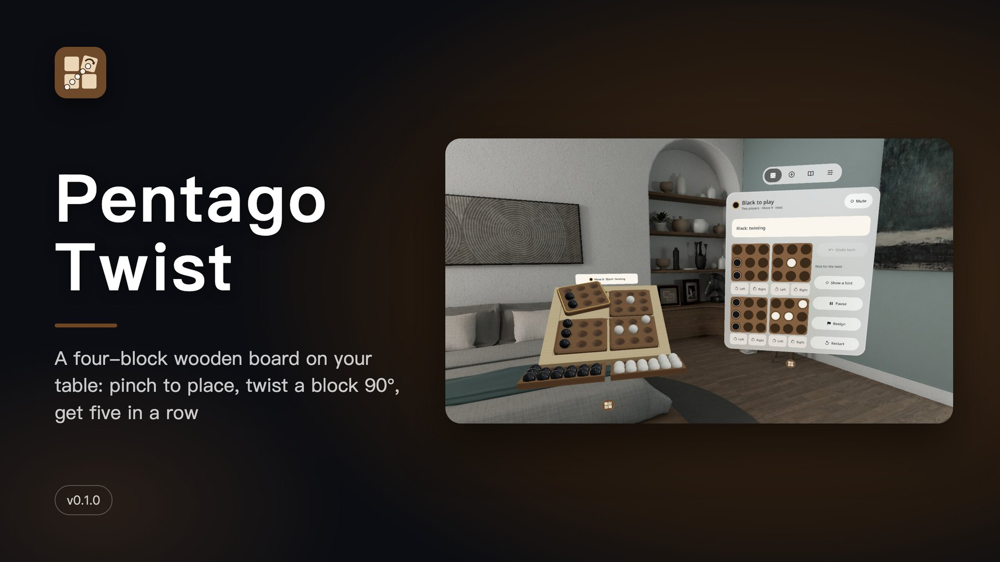

**A four-block wooden board on your table: pinch to place, twist a block 90°, get five in a row, against three AI levels.**

A PICO spatial app (PICO OS 6 · Spatial SDK BOM 6.1.9 · Shared Space volume). A 0.50 m board sits in front of you: four 3×3 walnut blocks set in a light maple frame, with two shallow trays of black and white glass marbles at hand. The rules are classic Pentago: each turn, place one marble, then twist any one of the four blocks a quarter turn. Five in a row across, down or diagonally wins.

### Features

- **Place**: point at a dimple and pinch; a marble arcs out of the tray and clicks into place
- **Twist**: hold a block and push, or tap the curved arrow beside it; it lifts, turns 90° with its marbles and drops back with a wooden click
- **Five after the twist**: a five that only appears after the twist lights up marble by marble
- **Opponents**: three local AI levels (Beginner / Club / Strong) or two players on one headset; undo a round, take back the marble, hint, resign, restart
- **Native system windows**: the board lives in a system volume; the control window on its right has four pages (Game / New game / Rules / Settings), and the Game page's mini board (36 cell keys + 8 twist keys) goes through the same path as a pinch on the board
- Tilt 0° / 30° / 45° / 60° / 90°, size 100% / 120%; autosave every move; three volume levels, mute, reduced motion; hand pinch and controller ray; Chinese and English; fully offline, no account

### Screenshots

> v0.1.0 PICO emulator screenshots (English UI), driven by debug broadcasts — **not a recording of real hand input**. The demo video `video-01.mp4` is a Release asset (also not real hand input, no sound).

| | |
|---|---|
| 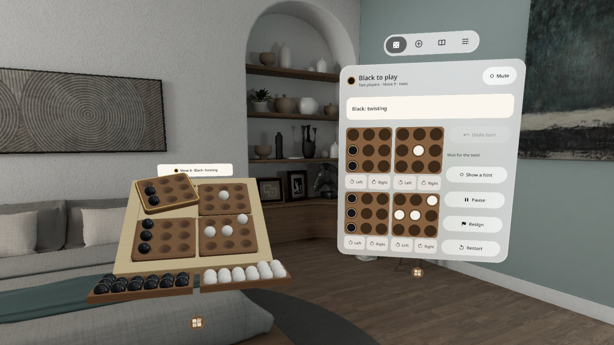 Twisting: after placing c4, Black turns the top-left block 90° clockwise; it lifts and turns with its marbles | 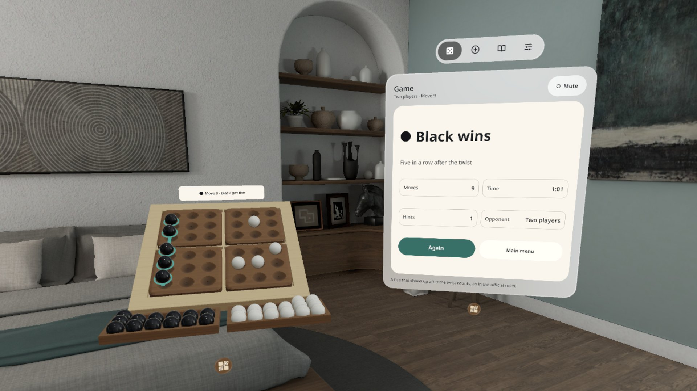 Five after the twist: column a lights up, the panel says "Black wins · Five in a row after the twist" |
| 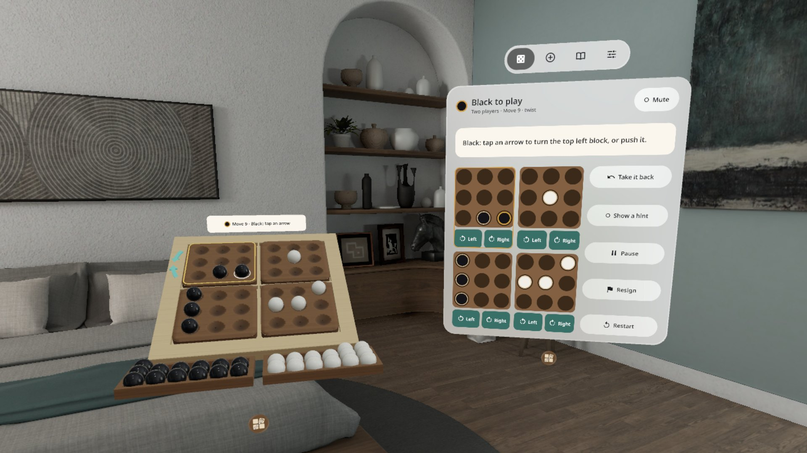 Block picked: the top-left block's rim lights, the arrows come out, the mini board's twist keys turn green | 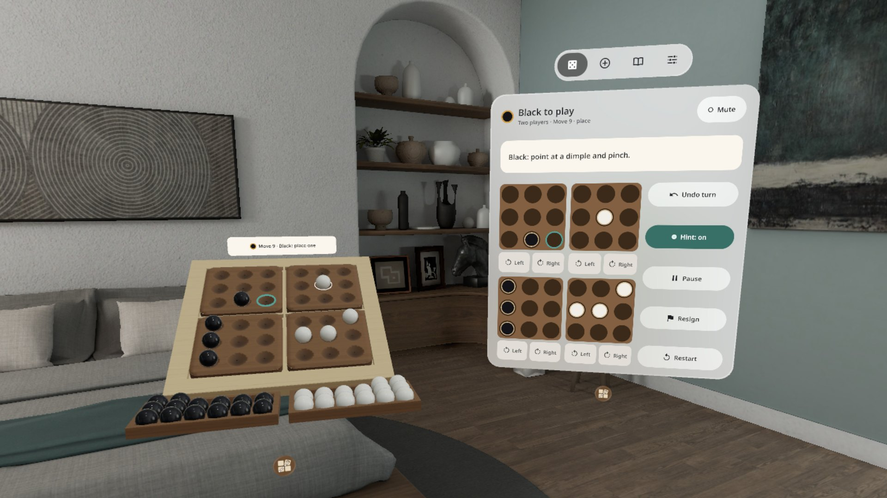 Hint on: a teal ring marks the suggested dimple on the board and on the mini board |
| 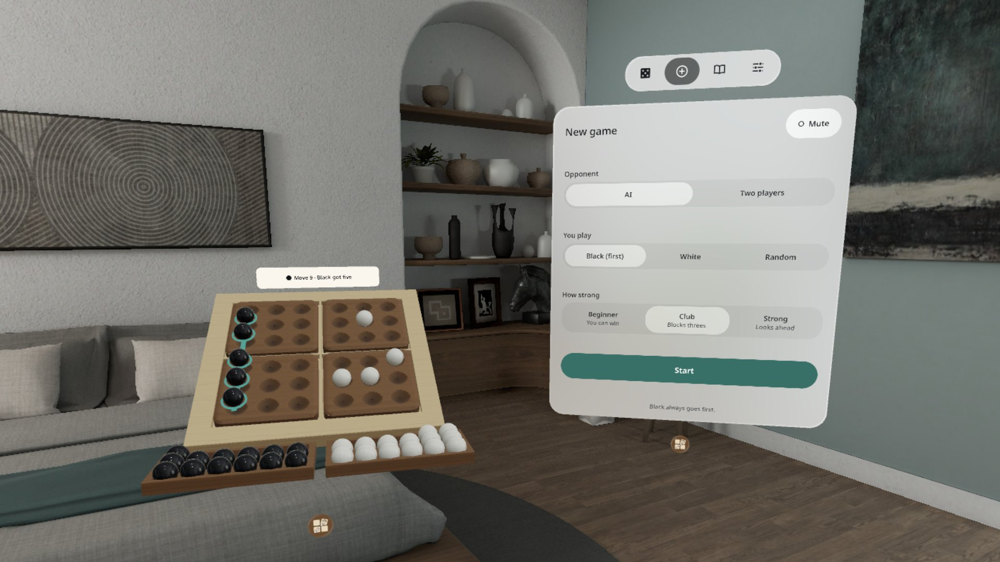 New game: AI / two players, Black / White / Random, three levels | 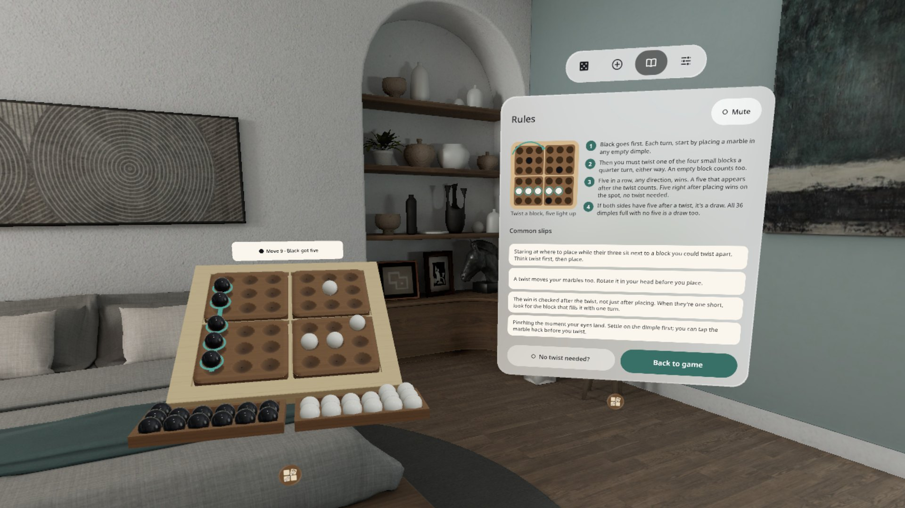 Rules: one diagram, four rules, common slips |

### Install

`PentagoTwist-v0.1.0.apk` in [Release v0.1.0](https://github.com/kejing-dev/PentagoTwist/releases/tag/v0.1.0) is an unsigned `assembleRelease` build (for store submission; `adb install` rejects it). To install it yourself, build the debug APK from source, enable developer mode on the headset and connect it over USB:

```bash
./gradlew assembleDebug
adb install -r app/build/outputs/apk/debug/app-debug.apk
pico-cli app launch io.embodit.pentagotwist
```

Requires PICO OS 6 (Android 15, minSdk 35). No extra permissions.

### Known issues

1. The first-game coach line promises a ghost marble where you look; on a headset it usually does not appear (Shared Space does not deliver hover).
2. While a marble is flying or a block is turning, the reason under the greyed-out [Undo turn] does not match the current action.
3. On a cold start a plain fallback slab shows for about 3 seconds, and the real board jumps slightly when it loads.
4. The move tile over the far rim uses small text.
5. Sounds are not spatial (they do not play from the marble's position).
6. Controller ray, hand ray and eye-hand input and the sound were tried by the user on a headset but not logged item by item.
7. A larger 8×8 board, game codes, stats, more AI levels and puzzles come in a later version.

### Version history

- **v0.1.0**: first version — four-block board volume + control window, Pentago rules (place one + must twist one, five wins, double five / full board draws), three AI levels, two players on one headset, marble flight / twist / five-light animations, CC0 sounds, five tilt angles, Chinese and English

### License and assets

- Font: Noto Sans (SIL OFL 1.1, see `third_party/`)
- Sounds: CC0 1.0 recordings from Kenney (kenney.nl) impact-sounds and freesound (KaleidacousticsAudio); the "occupied" cue is synthesized; sources in `tools/sound-sources.txt`
- Board, block, marble and tray models are generated in pure Python by `tools/build_models.py`
- Classic Pentago rules
- This repository is public; developed with Claude Code on the "lights-out factory" pipeline (Claude Opus 5.5 for build / QA / release, Claude Fable 5.1 for research / design)
- Project structure and debug commands: [AGENTS.md](AGENTS.md)
